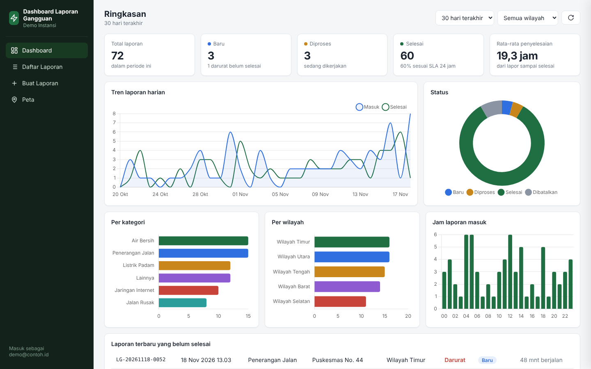
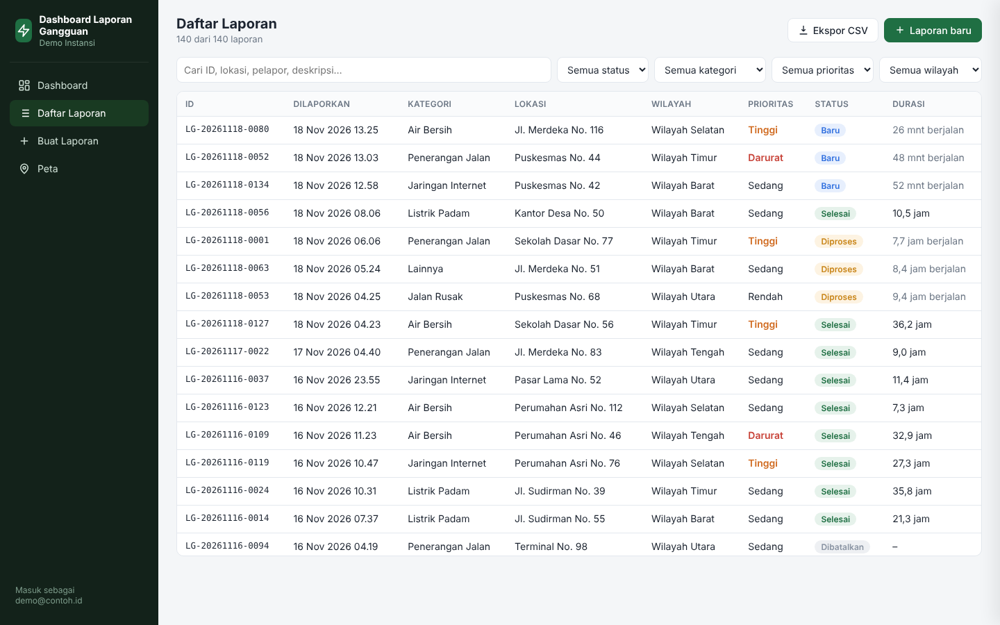
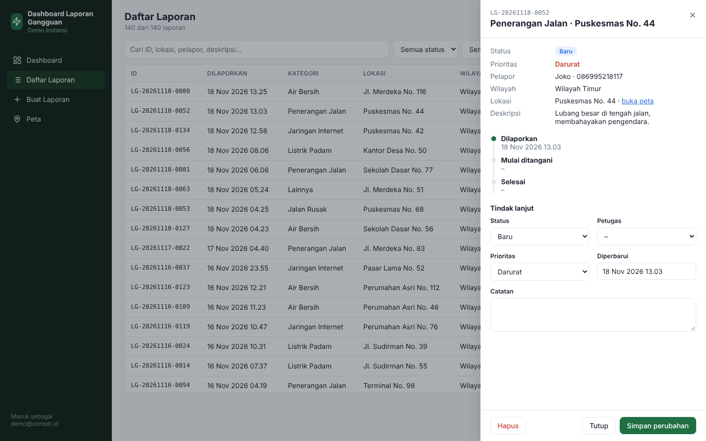
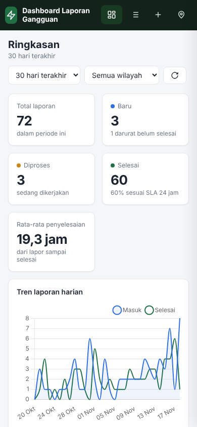

# Dashboard Laporan Gangguan

Template dashboard monitoring gangguan yang berjalan di **Google Apps Script** dengan **Google Sheets** sebagai database. Gratis, tanpa server, dan bisa dipasang dalam 10 menit.

Cocok untuk instansi kecil, kantor desa, sekolah, unit layanan, atau tim teknis yang perlu mencatat dan memantau laporan gangguan (listrik, jaringan, air, fasilitas umum, dan lain-lain).

**[Coba demo langsung](https://misbah2121.github.io/dashboard-laporan-gangguan/)** · data demo, tersimpan di browser kamu saja

## Fitur

- **Ringkasan**: total laporan, jumlah per status, persentase sesuai SLA, dan rata-rata waktu penyelesaian
- **Grafik**: tren harian (masuk vs selesai), status, per kategori, per wilayah, dan jam laporan masuk
- **Filter periode & wilayah** di halaman ringkasan
- **Daftar laporan** dengan pencarian dan filter status, kategori, prioritas, dan wilayah
- **Detail & tindak lanjut**: ubah status, petugas, prioritas, dan catatan; waktu mulai dan selesai tercatat otomatis
- **Form laporan baru** dengan penanda lokasi di peta
- **Peta gangguan** (OpenStreetMap) dengan warna sesuai status
- **Ekspor CSV** sesuai filter yang aktif
- **Log aktivitas** di sheet terpisah
- **Responsif**, bisa dipakai dari HP
- **Bisa diatur tanpa ngoding**: kategori, wilayah, petugas, nama instansi, dan target SLA diubah langsung di spreadsheet

| Daftar laporan | Detail & tindak lanjut | Tampilan HP |
|---|---|---|
|  |  |  |

## Cara Memasang

1. Buat **Google Spreadsheet** baru.
2. Buka **Extensions → Apps Script**.
3. Ganti isi `Code.gs` dengan isi file [`Code.gs`](Code.gs) dari repo ini.
4. Klik **+ → HTML**, beri nama `Index`, lalu tempel isi [`Index.html`](Index.html).
5. Pilih fungsi **`setup`** di toolbar, lalu klik **Run**. Izinkan akses saat diminta.
   Sheet `Laporan`, `Master`, `Config`, dan `Log` akan dibuat otomatis.
6. *(Opsional)* Jalankan **`seedDemoData`** untuk mengisi 80 contoh laporan.
7. Klik **Deploy → New deployment → Web app**:
   - *Execute as*: **Me**
   - *Who has access*: sesuai kebutuhan (misalnya **Anyone with Google account** atau hanya domain instansi)
8. Buka URL web app yang diberikan.

Untuk menghapus data contoh, jalankan `clearAllReports`.

## Pengaturan

Semua pengaturan ada di spreadsheet, tidak perlu mengubah kode.

**Sheet `Config`**

| Kunci | Fungsi |
|---|---|
| `APP_NAME` | Judul aplikasi |
| `ORG_NAME` | Nama instansi yang tampil di sidebar |
| `ADMIN_EMAILS` | Email yang boleh menghapus laporan (pisahkan dengan koma). Kosong = semua boleh |
| `MAP_CENTER` | Titik tengah peta, format `lat, lng` |
| `MAP_ZOOM` | Zoom awal peta |
| `SLA_HOURS` | Target penyelesaian dalam jam |

**Sheet `Master`**: setiap kolom adalah daftar pilihan (`Kategori`, `Prioritas`, `Wilayah`, `Status`, `Petugas`). Tambah atau ubah isinya, dan dropdown di aplikasi ikut berubah.

> Catatan: pembatasan admin lewat `ADMIN_EMAILS` hanya bekerja bila email pengguna terbaca oleh Apps Script, misalnya saat semua pengguna berada di domain Google Workspace yang sama.

## Struktur Data

Setiap laporan disimpan satu baris di sheet `Laporan`:

`ID · Tanggal Lapor · Pelapor · Kontak · Kategori · Prioritas · Wilayah · Lokasi · Latitude · Longitude · Deskripsi · Status · Petugas · Tanggal Mulai · Tanggal Selesai · Catatan · Diperbarui`

ID dibuat otomatis dengan format `LG-YYYYMMDD-0001`.

## Teknologi

- Google Apps Script (V8) + Google Sheets
- HTML, CSS, JavaScript tanpa framework
- [Chart.js](https://www.chartjs.org/) untuk grafik
- [Leaflet](https://leafletjs.com/) + OpenStreetMap untuk peta

## Lisensi

[MIT](LICENSE). Bebas dipakai, diubah, dan dibagikan, termasuk untuk keperluan instansi.

---

Dibuat oleh [@misbah2121](https://github.com/misbah2121)
